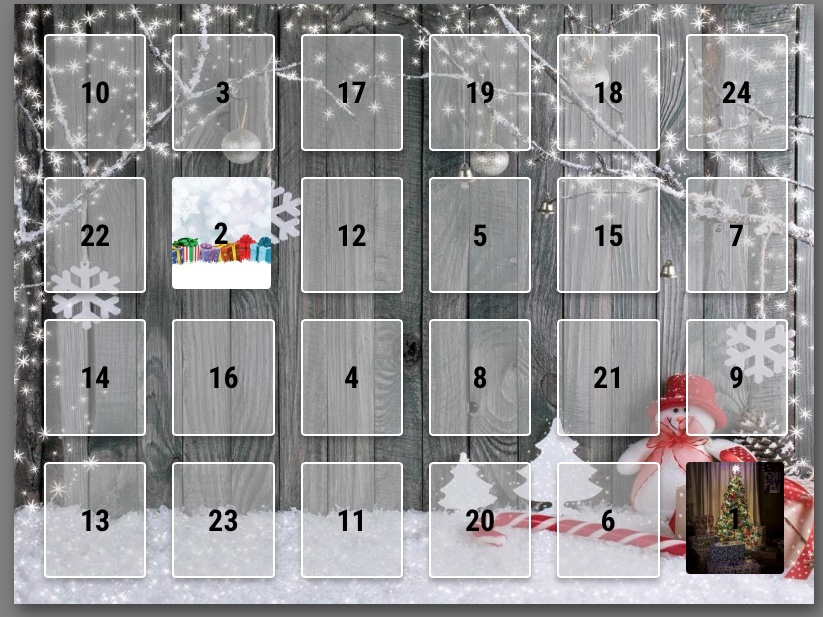

# MMM-Adventskalender
The MMM-Adventskalender is a custom MagicMirror² module designed to display an interactive Advent calendar with 24 numbered doors arranged in a 6x4 grid. Each door corresponds to a date in December (1-24) and hides an image behind it. The module supports manual and automatic door opening, state saving, animations, and a customizable appearance.

It could contain some bugs and may not be perfect at this time. Let me know what you notice, and I will try to improve it.




## Installation

### Install

In your terminal, go to your [MagicMirror²][mm] Module folder and clone MMM-Adventskalender:

```bash
cd ~/MagicMirror/modules
git clone https://github.com/ChrisF1976/MMM-Adventskalender.git
```

### Update

```bash
cd ~/MagicMirror/modules/MMM-Adventskalender
git pull
```

## Using the module

To use this module, add it to the modules array in the `config/config.js` file:

```js
{
    module: "MMM-Adventskalender",
    position: "top_center",
    config: {
        backgroundImage: "/modules/MMM-Adventskalender/images/background.jpg",
        doorMargin: 30,
        moduleWidth: 800,
        moduleHeight: 600,
        autopen: true,
        autoopenat: "10:00",
    },
},

```


## Configuration options

Option|Possible values|Default|Description
------|------|------|-----------
`backgroundImage`|`string`|`null`|Path to your background image.
`doorMargin`|`integer`|`30`|Margin around each door in px.
`moduleWidth`|`integer`|`800`|Total width of the module in px.
`moduleHeight`|`integer`|`600`|Total height of the module in px.
`autopen`|`boolean`|`true`|Opens the door of the day automatically (and all doors of past days). Useful in headless mode. Each door is opened automatically only once, so you can close it again manually.
`autoopenat`|`string`|`"00:00"`|Time (`"HH:MM"`) when the door of the day opens automatically.
`openAnimationTime`|`string`|`"5s"`|Duration of the opening/closing animation (CSS time, e.g. `"2s"` or `"800ms"`).
`showCursor`|`boolean`|`true`|Shows the mouse cursor inside the calendar, even if the cursor is hidden everywhere else in MagicMirror (e.g. by a cursor-hiding module or `cursor: none` in `custom.css`). Set to `false` to keep the cursor hidden, e.g. on touchscreens.

Notes:
- The cursor override only works for cursors hidden via CSS. If the cursor is hidden at system level (e.g. with `unclutter`), it can't be shown by the module.
- Doors can only be opened in December. Outside of December all doors stay closed.
- The state is stored in `state.json`. A new calendar (new random order, all doors closed) is created automatically when the year changes, or when the file is missing or invalid. Delete `state.json` to reset the calendar manually.


## Pictures
- choose a background picture
- choose 24 other pictures for the door and name it 01....24
- I took the pictures as a proof of concept from [Pixabay](https://pixabay.com). The images `13.jpg`–`24.jpg` are copies of `01.jpg`–`12.jpg` – replace them with your own pictures.

## Features:
### Visual Design and Layout
- Grid Layout: 6x4 grid of 24 doors.
- Customizable Appearance:
    - Adjustable module width, height, and door margin.
    - Optional background image filling the entire module.
    - CSS animations for door opening and closing effects.
### Door Interaction
Manual Door Interaction:
 - Click to Open/Close: Clicking a closed door opens it with an animated rotation.
 - Closing: Already opened doors can be closed manually.
### Automatic Features
Auto-Opening Doors:
- If enabled (autopen: true), doors corresponding to past or current dates in December open automatically.
- Configurable opening time (autoopenat: "HH:MM").
### Persistent State Management
State File (state.json):
 - The door states (opened/closed) and randomized door numbers are saved persistently.
 - If the state file is missing or corrupted, a new one is created automatically.
### Animations
Door Opening Animation:
 - 3D rotation animation from the right edge when opening.
 - Reverse animation when closing.
### Module Configuration Options
Appearance:
- backgroundImage: Path to a custom background image.
- moduleWidth, moduleHeight: Adjust module dimensions.
- doorMargin: Space between doors.
- Door Behavior:
    - autopen: Enables automatic door opening (true/false).
    - autoopenat: Time to open the door automatically (e.g., "10:00").


[mm]: https://github.com/MagicMirrorOrg/MagicMirror
